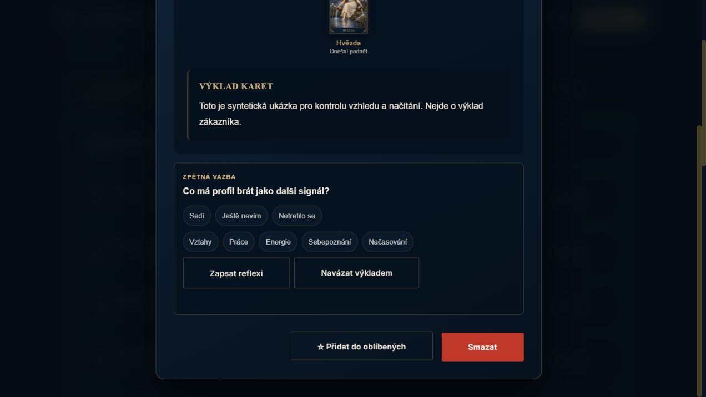

# PF01 — spolehlivý detail výkladu

15. 10. 2026 · místní kandidát po `7b3303d6` · bez nasazení a bez produkčních dat.

## Změna

- Každé otevření má vlastní pořadí a ruší předchozí GET. I pokud transport zrušení ignoruje, stará odpověď ani její chyba se nevykreslí.
- ID načteného obsahu musí odpovídat požadovanému záznamu. Oblíbené a mazání se povolí až po úspěšném vykreslení; při načítání, chybě a běžící změně jsou vypnuté.
- Akce zachytí ID při spuštění. Výsledek změny A nesmí změnit stav ani zavřít nově otevřený detail B.
- Přepnutí otevřeného detailu zachová jeden posluchač klávesnice a původní cíl pro návrat fokusu.

## Nezávislé ověření

`npm run test:unit:frontend -- --runTestsByPath tests/frontend/profile-modal.test.js` — **11/11**. Test importuje skutečný modul; API, další profilové moduly a minimální DOM jsou modelové. Pokrývá opožděné A/B včetně JSON fáze a ignorovaného abortu, zavření, chybu a nesouhlas ID, vypnutí akcí, souběh změny oblíbených/mazání, chyby mutací a fokus.

Skutečný build profilu v aplikaci na `localhost:3348`, `MOCK_SUPABASE=true`, `MOCK_AI=true`, pouze účet `ukazka@example.invalid`: otevření syntetického tarotu, odebrání hvězdičky a Escape. DOM potvrdil skrytý dialog, obě akce disabled a návrat na `data-reading-action=view`, ID `fixture-reading-063`.

Build JS, cílený ESLint `js/profile/modal.js`, `git diff --check`, cache a validace SW assetů prošly. Cache `mysticka-hvezda-2d948d0f3df4`.

## Omezení a další krok

Mazání bylo ověřené řízenou modelovou odpovědí, nikoliv smazáním skutečného zákaznického výkladu. Nejde o kompletní audit všech historických datových formátů ani plateb. PF02/PF03 zůstávají otevřené: obnova deníku/oblíbených a podklady nezávislé na první stránce historie.

Pomocník `gpt-5.6-luna`, medium, provedl pouze zdrojový průzkum PF02/PF03; doporučil společný refresh a oddělení profilových podkladů. Implementaci PF01 a její ověření provedl hlavní agent, bez eskalace.
