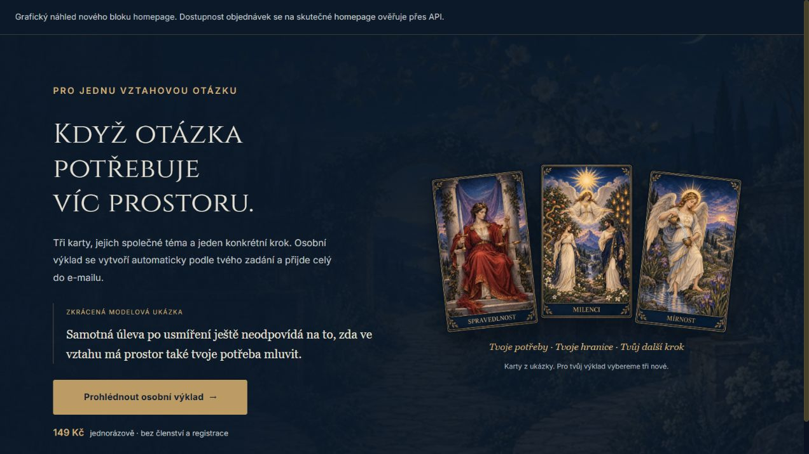
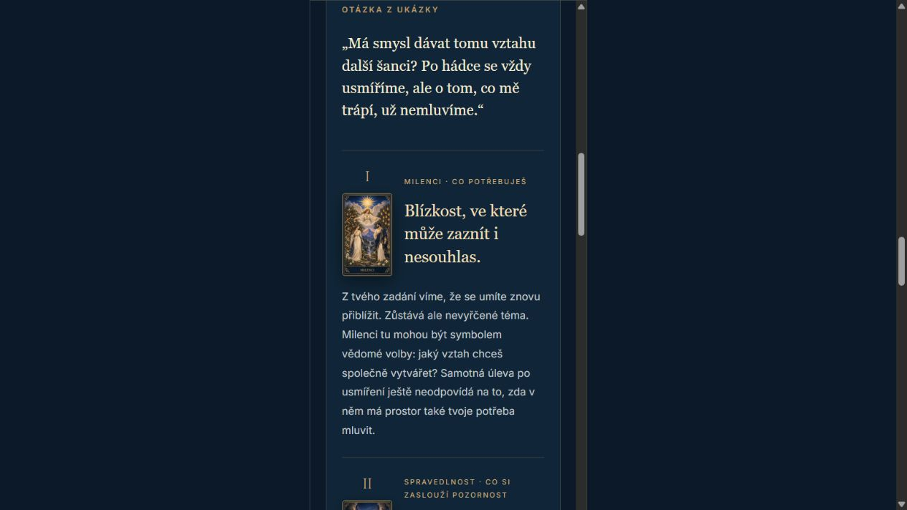

# Vizuální dokončení homepage a osobního výkladu

Dokončeno lokálně 12. 10. 2026; práce navazuje na návrh z 11. 10. Náhled je v [overview.html](overview.html). Žádný deploy, objednávka, placené generování ani nový zákaznický e-mail.

## Hotových pět úprav

1. **Obrazová ukázka na vztahovy-vyklad.html.** Každá ze tří částí má odpovídající kartu z tarot-v2, římské číslo a popisek. Stávající praktická věta je samostatně zvýrazněná. Na mobilu jsou karta s nadpisem vedle sebe a odstavec pod nimi přes celou šířku; nepřibývají vymyšlené příběhy či reference.
2. **Výklad za 149 Kč na homepage.** Vlastní blok před členstvím, tři ukázkové karty, zkrácená označená modelová ukázka, vysvětlení automatického vzniku a jednorázová cena. Přechod vede na stávající produkt se source=homepage_relationship_spotlight. Použit existující relationship-tarot-bridge pro ověření dostupnosti, měření a flow; žádný další checkout nebo povinný účet.
3. **Klidnější karta dne.** Kratší text, skrytá opakovaná pravá nápověda před otočením, výraznější název a praktický krok po otočení. Data, výběr karty, návrat z profilu a URL návazností jsou původní; JS nástroje se neupravoval.
4. **Decentní pozadí.** Existující malovaná společná cesta za novým homepage blokem, noční zahrada za ceníkem a zápisník za vysvětlením obsahu osobního výkladu. Tmavé překrytí drží čitelnost; žádné další generované soubory.
5. **Sladěný e-mail.** Navy #0b1929/#102638, tlumená zlatá #bd9b65 a krémová plocha #f8f3e9 pro čtení. HTML tabulky, CID karty, textové escapování, obsah, podmínky a způsob doručení zůstávají zachované. Modelový e-mail je výstup skutečného rendereru se syntetickým zadáním; žádná zákaznická data.

## Ověření

- Skutečné lokální stránky prohlédnuty v prohlížeči. Ukázka obsahuje tři odpovídající ilustrace, návazný odkaz z homepage náhledu vede na původní výklad. Všechny obrazové reference existují: 8 v produktové stránce včetně log a 3 v homepage bloku. Tři homepage karty se skutečně načetly.
- Karta dne na homepage se ručně otočila, objevil se název, význam, zvýrazněný krok i původní odkazy. Nebyla objednána ani odeslána placená služba.
- Změna viewportu přes prohlížečovou capability se nepropisovala: naměřeno stále 1280 px, proto to nebylo vydáváno za mobilní test. Mobil byl následně skutečně ověřen v iframech o šířce 390 px. V ukázce a e-mailu clientWidth/scrollWidth=375/375, v homepage bloku 382/382; rozdíl souvisí se scrollbar. Bez vodorovného přetékání. Odstavec mobilní ukázky má po doladění šířku přibližně 286 px místo původního úzkého sloupce vedle karty.
- `css/home.min.css` sestaveno ze skutečných vstupů projektu. Obě reference na bundle mají cache token 20261012-reading-finish, produktová stránka má vlastní CSS token 20261012-illustrated-reading. Service worker aktualizován existujícím skriptem, snapshoty veřejných assetů zachované. Diff kontrola bez chyb, pouze obvyklé CRLF upozornění.
- Pro samotné barvy a rozložení se nespouštěla celá testovací sada. E-mail byl skutečně vyrenderován; toto není ověření všech poštovních klientů ani skutečného nového doručení.

## Lokální omezení nabídky

Server náhledu na portu 3212 nedodává potřebné produktové API. Nová nabídka proto na skutečném index.html správně zůstává skrytá, pokud produkt nelze ověřit. V overview.html je grafická podoba stejného HTML bloku zobrazena samostatně v jasně označeném náhledu bez marketingového/checkout JS. Nejde o důkaz zapnutí objednávek. Na produkci bude blok viditelný až po kladné odpovědi současného API.

## Soubory

- `index.html`, `css/pages/home-atlas.css`, vygenerovaný `css/home.min.css`;
- `vztahovy-vyklad.html`, `css/pages/vztahovy-vyklad.css`;
- pouze HTML e-mailový renderer v `server/services/relationship-tarot.js` (předchozí jazykové a doručovací opravy jsou samostatný balík);
- náhledy a screenshoty zde, aktualizovaná cache a asset snapshoty.

Pomocník gpt-6-sol medium upravil produktovou ukázku a e-mailovou paletu v oddělených souborech. Hlavní agent zkontroloval výstup, upravil mobilní čitelnost, dokončil homepage a ověřil skutečné náhledy. Nevznikl nový framework ani knihovna ikon. Produkční aktivace předchozích oprav doručování má vlastní [checkpoint](../relationship-tarot-fix-2026-10-11.md); toto vizuální kolo jej nenahrazuje.

## Náhledy

